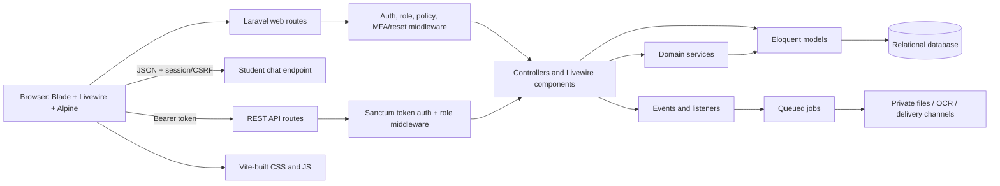
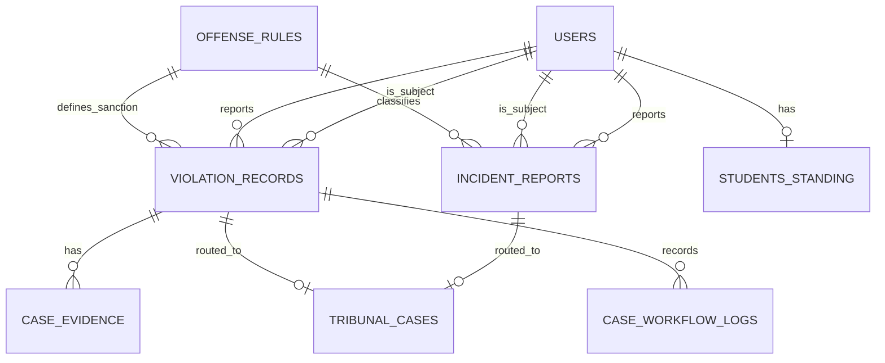

# Student Conduct Management System: Technical Guide

This guide describes the implementation in this repository, including where code paths are complete and where documentation, schema, or UI describes functionality that is not currently wired end to end. It is intended as a study and system-defense reference, not as a substitute for deployment-specific `.env` values or formal CSU policy.

## 1. System Overview

SCMS is a Laravel monolith organized around Laravel's MVC conventions, with server-rendered Blade pages and Livewire components for interactive screens. It is not a separate React/Vue frontend or a microservice architecture.

### Runtime and stack

| Area | Implementation |
|---|---|
| Language/runtime | PHP 8.4.20 reported by the running application; Composer permits PHP `^8.2`. |
| Backend | Laravel 12.53.0; Eloquent ORM; Laravel routing, middleware, validation, mail, filesystem, queue, events, and session services. |
| Interactive UI | Blade + Livewire 3.7.11; Volt 1.10.3 is used for auth pages; Alpine.js is provided by Livewire for small client-side interactions. |
| CSS/assets | Tailwind CSS 3.4.19; Vite 7 (declared as `^7.0.7`); `laravel-vite-plugin`; `@tailwindcss/forms`; Axios. |
| Database | MySQL was the active connection reported during inspection. Laravel configuration can also select SQLite, MariaDB, or PostgreSQL by environment. |
| Authentication and authorization | Laravel session authentication, Laravel Breeze/Volt scaffolding, Sanctum API tokens, and Spatie Laravel Permission 7.2 roles/permissions. |
| Background processing | Laravel queues. OCR uses a Python subprocess; notifications use Laravel jobs. Database queue tables are present. |
| Other packages | Laravel Excel (`maatwebsite/excel`) for spreadsheet workflows; Octane and Reverb packages are installed; PHPUnit 11 for tests. |
| OCR runtime | Python packages in `requirements.txt`: NumPy, OpenCV headless, PyMuPDF, and pytesseract. The Tesseract executable and language data must also be installed on the host. |

The app's Composer constraints and NPM scripts live in [`composer.json`](../composer.json) and [`package.json`](../package.json). Vite's build inputs/output are defined in [`vite.config.js`](../vite.config.js), and Tailwind scans Blade views in [`tailwind.config.js`](../tailwind.config.js).

### Architecture at a glance



This is a single deployable Laravel application with a layered application structure: routes select middleware and a controller/Livewire component; those components validate and authorize requests; Eloquent models/services perform domain work; Blade and Livewire render results. Events/jobs are used for selected asynchronous work, rather than every operation.

## 2. JAM Student Policy Assistant

### What powers it

JAM is **not calling OpenAI, Anthropic Claude, Google Gemini, or another hosted LLM**. The executed implementation is a custom multinomial Naive Bayes text classifier in [`ChatBrainService`](../app/Services/ChatBrainService.php), followed by a database lookup and hand-written response templates in [`StudentChatController`](../app/Http/Controllers/StudentChatController.php).

The repository does contain `services.anthropic` configuration (including a Claude model default) in [`config/services.php`](../config/services.php), but neither the JAM controller nor `ChatBrainService` uses it. An Anthropic key being present in an environment file would not change JAM's behavior by itself.

### Training and model storage

`php artisan jam:train` invokes [`TrainJamBrainCommand`](../app/Console/Commands/TrainJamBrainCommand.php):

1. Load active `offense_rules` rows.
2. Create text samples from each rule's title, description, and generated example questions/statements.
3. Add a small `greeting` intent corpus.
4. Train the Naive Bayes counts and vocabulary in memory.
5. Save the serialized JSON model to the local filesystem disk at `storage/app/private/jam_brain.json`.

The classifier lowercases and tokenizes input, removes punctuation and a small English stopword set, uses a vocabulary built from the training samples, and attempts Levenshtein distance matching for out-of-vocabulary words (maximum distance 2). It scores classes with log probabilities, add-one/Laplace smoothing, and a class prior. There is no learned text-generation step or calibrated confidence threshold; the winning label is selected from the available classes.

Retrain after offense rules change if JAM should learn those changes. The bot's actual response content is still read from `offense_rules` at request time, so a changed rule's wording/sanctions can be returned once its code is classified, while newly introduced language/synonyms may require retraining.

### Request and response path

```mermaid
sequenceDiagram
    participant UI as Offense Rules page (Alpine)
    participant Route as POST /student/chat
    participant Controller as StudentChatController
    participant Brain as ChatBrainService
    participant DB as offense_rules table
    UI->>Route: JSON messages, lang, studentName + session/CSRF
    Route->>Controller: auth + role:student middleware
    Controller->>Controller: Validate payload; select last user message
    Controller->>Brain: predict(last user message)
    Brain-->>Controller: greeting, offense code, or null
    Controller->>DB: Find rule by predicted code (not for greeting/null)
    DB-->>Controller: Rule data
    Controller-->>UI: JSON {reply}
    UI->>UI: Render formatted response; save local history in browser
```

Details that matter when explaining the flow:

- The view creates an initial greeting locally. It marks that synthetic message and removes it from the request payload.
- The UI sends at most the last 20 client-side message entries to `route('student.chat')`, with the CSRF token. The endpoint validates `messages` (1–40 entries, `user`/`assistant` roles, content up to 2,000 characters), language (`en`/`fil`), and a `studentName` string.
- The server uses only the **last user-role message** for classification. Previous user messages and assistant responses are not used as model context; there is no server-side conversation memory.
- For `greeting`, the controller returns a fixed bilingual welcome. For an offense code, it finds one `OffenseRule` and returns its code, category, severity, description, progressive sanctions, tribunal note, and OSA contact details in a bilingual template. A null prediction produces a clarification reply; a missing rule produces a generic policy fallback.
- The submitted name is client-provided and is used only in the greeting. Conduct/student records are not fetched for the chat. The route requires an authenticated student, but the code does not use the authenticated user's record as model context.
- JAM messages/replies are **not stored in the application database**. The browser stores a limited history under `localStorage` key `csu_chatbot_history` (up to 30 history entries, with the bot reply truncated for display). Clearing browser storage clears this history.
- If the JSON model file is missing/unreadable, the endpoint returns HTTP 503 and instructs the operator to run `php artisan jam:train`.

The UI implementation is in [`resources/views/student/offense-rules.blade.php`](../resources/views/student/offense-rules.blade.php); the route is declared in [`routes/web.php`](../routes/web.php).

## 3. Roles, Authentication, and Access Control

### Sign-in lifecycle

1. The login page is a Volt component at `resources/views/livewire/pages/auth/login.blade.php`; it accepts email or username.
2. [`LoginForm`](../app/Livewire/Forms/LoginForm.php) uses Laravel `Auth::attempt`, a configurable rate limiter, and writes success/failure/lockout events to `auth_audit_logs`.
3. The login route also has `throttle:5,1`. The user session ID is regenerated after successful authentication.
4. A user flagged `must_change_password` is sent to `/password/force-reset` before any dashboard. The forced-reset controller enforces its own policy, including a minimum 12-character password.
5. If `User::hasMfaRequired()` returns true, login redirects to `/mfa/verify`. MFA-required users include administrator role members, `role_type` value `system_auditor`, and users with `mfa_enabled` set.
6. MFA uses a six-digit OTP stored on the user, a 10-minute expiry and a maximum of three failed attempts. The OTP is mailed via `MfaOtpNotification`; verification state is stored as `mfa_verified` in the session and MFA attempts are audited.
7. Otherwise, the role sends the user to the administrator, staff, or student dashboard.

For ordinary web requests, `bootstrap/app.php` appends `SetLocale`, `EnsurePasswordResetOnFirstLogin`, and `EnsureMfaVerified` to the web middleware group. The session driver defaults to `database` (`sessions` table) and can be changed with environment configuration. Password-reset, email-verification, login, logout, and MFA routes are in [`routes/auth.php`](../routes/auth.php).

### Role gates and portal scope

| Role | Main routes | Access rule |
|---|---|---|
| Administrator | `/admin/*` | `auth` + Spatie `role:administrator`. Can use the administration dashboard, user management, report/case inbox, audit logs, settings, and evidence downloads. |
| Staff | `/staff/*` | `auth` + `role:staff\|administrator`. Staff can report incidents, manage the student roster and see their own report submissions. The report detail route additionally uses `can:view,report`. |
| Student | `/student/*` | `auth` + `role:student`. Student pages query records for the authenticated student's ID; the view/answer policy checks ownership. JAM's POST endpoint is in this group. |
| OSDW Administrator | Tribunal case routes | `auth` + custom `tribunal` middleware, which checks the `access tribunal module` permission assigned to the administrator role. |

Spatie middleware aliases (`role`, `permission`, `role_or_permission`) are registered in `bootstrap/app.php`; role and permission data uses `roles`, `permissions`, `model_has_roles`, `model_has_permissions`, and `role_has_permissions`. The `User` model also has a `role_type` column. These are two authorization-related representations: most route guards use Spatie roles, while MFA and the Tribunal gate also inspect `role_type`. Provisioning must keep the required values consistent.

Important policy behavior:

- `IncidentReportPolicy`: staff can see only reports they filed; administrators can see all reports.
- `ViolationRecordPolicy`: a student can view only their own record and can submit one written answer only while the case is `Notice Sent`, before the answer deadline. Staff/admin can view records; only admin can delete/restore/force-delete.
- Students' dashboard and record queries scope by `Auth::id()` in addition to route middleware.
- Tribunal access is a distinct `role_type` check; it should not be assumed to be equivalent to an `administrator` role.

API routes are separate under `/api`. `/api/login` issues Sanctum tokens; protected routes use `auth:sanctum` and role middleware. Administrators manage users; staff/admin manage students and incident resources; authenticated users manage notification preferences; `/api/v1` exposes offense and standing/clearance endpoints. Delivery webhooks are declared outside the Sanctum group and need provider-side authentication/signature controls appropriate to the deployment.

## 4. Primary User Workflows

### Staff / OSDW reporting

The staff UI has two principal report paths:

- **Quick Log:** Livewire loads offense rules with `gravity = minor`, verifies the student ID, accepts a description (minimum 10 characters), creates an `IncidentReport` of type `Quick Log` with no evidence, sets status to `Submitted`, and dispatches `IncidentReported`.
- **Formal Charge:** Livewire verifies the student, requires a detailed description (minimum 20 characters), an evidence file, and staff certification. It stores evidence on a non-public/local disk and creates a `Formal Charge` report. If the offense rule requires tribunal review, it creates/links a `TribunalCase` through `TribunalCaseRouter`; it then dispatches `IncidentReported`.
- **Legacy/page form:** `POST /staff/report` is handled by `StaffIncidentController::store`. It accepts Quick Log/Formal Charge and optional evidence, calls `DecisionSupportService`, and stores the top recommendation/score/keywords on the report. The two Livewire submission classes do not call that decision-support service; do not assume recommendation fields are populated for every report path.
- Staff can see their own reports, their dashboard counts and their submissions. Authorization is rechecked by `IncidentReportPolicy` on report detail.

The general decision-support engine is a separate deterministic keyword-weight matcher: it sums configured `decision_keywords.weight` values for active `decision_rules`, compares the score to each rule's threshold, sorts matches, and saves the top recommendation. It is advisory data, not an automatic finding or sanction.

### Administrator / OSDW case processing

1. New incident reports appear in the admin Livewire case-management inbox.
2. Admin can dismiss a report or accept it. Acceptance chooses the investigation type; formal charges and rules requiring tribunal review are routed as Tribunal cases.
3. The system counts prior `ViolationRecord`s for the same student/offense and selects the corresponding progressive sanction from `OffenseRule` (first/second/third, otherwise standard fallback).
4. It creates a `ViolationRecord` with a `CSU-YYYY-MM-NNNN` tracking number, `Pending Review` status, incident narrative, dates and a five-weekday answer deadline. Evidence is copied into the case evidence location and represented by `CaseEvidence` where present.
5. A tribunal-required record is linked to a `TribunalCase`. The source `IncidentReport` status becomes `Under Review by OSDW`; an audit-like `CaseWorkflowLog` entry records case creation.
6. Admin can email formal notices using `StudentChargeNoticeMail`. The case moves to `Notice Sent`, increments notice count (up to three), stores sender/time, and sets a five-weekday response deadline. This action also writes a workflow log.
7. Student can submit a written answer while eligible. The answer is saved, the status changes to `Under Investigation`, and a workflow log records submission. It is a response/defense, **not an appeal filing**.
8. Admin may move a case to investigation after an answer or after the answer deadline expires, schedule/mark a conference, assign SDT members, and apply a sanction. Resolution stores the deciding administrator, settlement authority, imposed/effective date, action, and `Sanction Active` status, with the action recorded in `CaseWorkflowLog`.

The main UI logic lives in [`app/Livewire/Admin/CaseManagement.php`](../app/Livewire/Admin/CaseManagement.php). Status helpers and tracking-number generation are in [`app/Models/ViolationRecord.php`](../app/Models/ViolationRecord.php).

### Student

- The student dashboard, profile, records list and details load records scoped to the logged-in user's ID.
- Students can view offense rules and sanctions, inspect their own conduct history, and submit a written answer/defense when an eligible notice is open.
- The policy checks ownership, status, duplicate submission and deadline on the server. Changing a record ID in the URL does not bypass this check.
- The offense-rules page includes JAM; JAM does not read the current student's case records.

### Tribunal

- The Tribunal case list first calls `TribunalCaseRouter` to create any missing links for active tribunal-severity reports and violation records.
- Severity levels `Major` and `Severe` are considered tribunal-review levels by `OffenseRule::requiringTribunalReview()`.
- Tribunal case status is a distinct enum progression: `under_informal_discussion` → `under_formal_investigation` → `resolution_drafted` → `case_resolved`. `TribunalCase::transitionTo()` rejects invalid jumps.
- OSDW administrators can inspect linked incident/violation/evidence data, update status, upload a tribunal document, and view the document.
- Uploads accepted by `TribunalDocumentController` are PDF/JPEG/PNG up to 20 MB, stored on the `tribunal` disk, and queued for OCR after commit.

### Appeal status vs appeal workflow

The repository contains `Appealed` statuses, an `appeal incidents` seed permission, appeal-deadline fields/helpers, and UI filters. However, the inspected web routes, policies, controllers and live schema contain no appeal submission endpoint or dedicated appeals table/handler. The student detail page instead says to contact OSDW. The current implemented student submission is the written answer described above. The separate `/api/v1/offenses` resource accepts `APPEALED` as an offense status, but that is not an end-to-end student appeal process in the primary web case workflow.

## 5. Database and Domain Modules

The running MySQL schema contains Laravel infrastructure tables as well as SCMS domain tables. Migrations are in [`database/migrations`](../database/migrations/); the following are the central data groups.

### Core case/report model

| Table | Purpose and relationships |
|---|---|
| `users` | Login identity, student profile fields, `role_type`, password-reset/MFA/suspension state, soft delete. One user may be a student, reporter, decision maker, notification recipient, or audit actor. |
| `offense_rules` | Policy catalog: code/title/description/category/severity/gravity, progressive sanctions, tribunal requirement and active flag. Referenced by incident reports and violation records. |
| `incident_reports` | Staff-originated report, reporter/student/offense foreign keys, type, narrative, evidence path, status, tracking number, optional decision-support recommendation fields. Belongs to reporter, student and offense rule; may have a tribunal case. |
| `violation_records` | Formal case record created after report acceptance; student/offense/reporter/authority/decision-maker references; tracking number, status, answer/deadlines, sanctions, hearing/conference, resolution and access-log fields. Has evidence and workflow logs; may link to one tribunal case. |
| `case_evidence` | Private evidence metadata and storage path for a violation record; records uploader, MIME, size, evidence type and description. |
| `case_workflow_logs` | Case action-history records with actor, action type/details, JSON metadata, IP and user agent. Includes events such as charge filed, answer submitted, hearing, sanction, appeal filed, status change and access. |
| `tribunal_cases` | Tribunal case identity/status/document/searchable OCR text; optionally belongs to an incident report and/or violation record. |

Relationship sketch:



### Supporting modules

- **RBAC:** `roles`, `permissions`, `model_has_roles`, `model_has_permissions`, `role_has_permissions` (Spatie).
- **Security/audit:** `auth_audit_logs` records login/MFA events; `audit_logs` is a general entity/action/change record table.
- **Decision support:** `decision_rules` and child `decision_keywords` hold weighted keyword recommendations.
- **Notification engine:** `notifications`, `notification_preferences`, `notification_rules`, `notification_templates`, and `notification_channel_logs` store delivery intent, user preferences, templates and channel outcomes.
- **Separate offense/standing subsystem:** UUID-keyed `offenses`, `digital_evidence`, and `students_standing`. `OffenseStatusChanged` triggers `EvaluateStudentStanding`, which calculates GOOD/REVIEW/PROBATION/SUSPENDED/EXPELLED from `offenses` statuses and sanctions. This listener does not calculate standing from the primary `violation_records` workflow.
- **Settings and framework support:** `settings`, `sessions`, `personal_access_tokens`, `password_reset_tokens`, `jobs`, `job_batches`, `failed_jobs`, `cache`, `cache_locks`, and `migrations`.

There is no dedicated `appeals` table in the inspected schema. `appeal_deadline` and status fields are on existing records.

### Migrations and seeders

Migrations cover the initial user/auth tables, Spatie RBAC, offense rules, incident reports, violation workflow/evidence, tribunal cases, security fields, notification tables, decision rules, student standing, digital evidence, and later routing/review columns. Apply schema changes with `php artisan migrate` (or `--force` in a controlled production deployment), not manual edits to the production DB.

`DatabaseSeeder` runs `RoleSeeder`, `CSUOffenseRuleSeeder`, and `DecisionSupportSeeder`, and creates example admin/staff/student accounts. It does **not** call `SettingsSeeder`, `StudentConductSeeder`, or `CSUOffenseRulesCompleteSeeder` by default. Review those seeders and remove/change seeded credentials before any production use; never use a destructive `migrate:fresh --seed` against production data.

## 6. Events, Queues, Notifications, and OCR

### Queued work

- `ProcessDocumentOcr` is a Laravel queued job. It reads the configured disk/path, runs `scripts/ocr_processor.py` through Symfony Process, waits up to 300 seconds, and writes extracted text to `tribunal_cases.searchable_text`.
- Python OCR converts PDF pages to images with PyMuPDF, preprocesses grayscale/blur/threshold using OpenCV, then calls pytesseract. Configure `PYTHON_BINARY` if needed and set `TESSERACT_CMD` / `TESSERACT_LANG` for the host's Tesseract installation.
- `SendNotificationJob` retries up to three times with 1/5/15 second backoff and writes failure state/log context.
- `composer run dev` starts the web server, `queue:listen`, Pail log tail, and Vite dev server concurrently. Production needs a persistent queue worker for jobs configured on an asynchronous queue connection.

Queue defaults in `config/queue.php` to `database`, but `config/notifications.php` independently defaults its notification connection/queue to `redis` if `QUEUE_CONNECTION` is absent. Configure Redis or set the notification queue connection appropriately; otherwise the notification worker/connection can diverge from the normal queue default.

### Notification implementation boundary

A reusable notification service maps event config to recipients/channels, filters preferences/quiet hours, renders a DB/config template, saves a `notifications` row, then queues `SendNotificationJob`. Email and SMS channel classes call the configured mailer/provider. The notification row is persisted before channel delivery; `InAppChannel`'s Reverb/Echo broadcast call is commented out, so it currently logs rather than emitting a real-time event.

Runtime `php artisan event:list` showed listeners for `ComplaintFiled` → `SendComplaintNotifications` and `OffenseStatusChanged` → `EvaluateStudentStanding`. It did **not** show a listener for `IncidentReported`; although report flows dispatch that event and its comment says it can notify OSDW, the event does not implement `ShouldBroadcast` and has no registered listener in the inspected runtime. Treat automatic OSDW notification on report submission as unwired unless deployment code adds a listener.

There is an additional schema/code mismatch to resolve before relying on all generic notification recipient mappings: `RecipientMapper` looks up a `tribunal_case_id` column on `violation_records`, while the inspected live table has no such column; the current relationship is `TribunalCase.violation_record_id`.

## 7. Build, Routes, and Deployment

### Asset pipeline

- `resources/css/app.css` contains Tailwind's base/components/utilities directives.
- `resources/js/app.js` imports `resources/js/bootstrap.js`, which configures Axios request headers. Alpine behavior is primarily in Blade, with Livewire bundling its Alpine integration.
- `vite.config.js` builds `resources/css/app.css` and `resources/js/app.js` through `laravel-vite-plugin` into `public/build`, updating `public/build/manifest.json`.
- All page shells use `@vite(...)`; Livewire shells include `@livewireStyles` and `@livewireScripts`.
- Development uses `npm run dev`; production/static asset compilation uses `npm run build`.

### Important route groups

- `routes/web.php`: public welcome/landing and language routes; authenticated role dashboard redirect; student, staff, admin, and Tribunal web portals; private evidence downloads.
- `routes/auth.php`: Volt login/register/password reset/verification views, throttled login/MFA resend, forced password reset, MFA verification and logout.
- `routes/api.php`: Sanctum token API, role-protected CRUD, standing/clearance APIs and delivery webhooks.
- `bootstrap/app.php`: Laravel 12 route registration, middleware aliases, global web middleware additions, and `/up` health route.

Blade/livewire views are paired with route-declared controllers or Livewire page classes. The admin screens use Livewire routes and the staff/student screens mostly use controllers returning Blade views with embedded Livewire components.

### Deployment checklist

1. Install PHP dependencies (`composer install`) and Node dependencies (`npm install` or the deployment's lockfile-safe equivalent).
2. Configure `.env` for `APP_KEY`, HTTPS `APP_URL`, MySQL connection, session/cache/queue drivers, mail, SMS credentials (if used), and storage. Never commit real credentials.
3. Run `php artisan key:generate` for a new installation; run `php artisan migrate --force` for production schema changes after backup/review.
4. Seed only intentionally selected reference data/roles. Inspect `DatabaseSeeder` because it includes development accounts/passwords; do not blindly run it in production.
5. Build assets with `npm run build`; deploy `public/build` and its manifest together.
6. Ensure the web server document root points to Laravel's `public/` directory and PHP extensions meet Composer requirements.
7. Run a Laravel queue worker for OCR and other async jobs. Install Python requirements from `requirements.txt` and system Tesseract binaries/language data for OCR.
8. Run `php artisan jam:train` after offense-rule data is seeded or changed, and ensure the generated local model file is present/readable by every app instance that serves student chat. With multiple web instances, share or deploy the same trained model.
9. There are no project-specific recurring scheduled tasks in `routes/console.php`; it currently contains only Laravel's `inspire` sample command. No Laravel scheduler cron entry is needed for a project-defined scheduled task at present.
10. Validate with `php artisan test --compact` and monitor queue failures/logs after deployment.

## 8. Implementation Boundaries to Mention in an Evaluation

- **JAM uses a local classifier + templates**, not a generative LLM. No system prompt or student case context is sent to an external model.
- **Written answer is not appeal filing.** Appeal permissions/status names are present, but the primary web appeal transaction is not implemented.
- **There are two conduct data models.** The primary portals work mainly with `IncidentReport` → `ViolationRecord` → `TribunalCase`; the API/standing engine also has `Offense` → `StudentStanding`. Do not describe them as one unified pipeline without further integration.
- **Report notification event is currently unwired.** Dispatching `IncidentReported` alone does not call the generic NotificationService or broadcast to admins in the inspected runtime.
- **Reverb is installed, not proven active for notifications.** The client bootstrap only imports Axios, and the in-app broadcaster call is commented out.
- **README stack labels are stale in places.** It lists PHP 8.5 and PostgreSQL as if they were runtime facts; the inspected runtime reported PHP 8.4.20 and MySQL. Composer allows PHP `^8.2`; database connection is environment-selected.
- **Settings seeding is separate.** `SettingsSeeder` is not called by `DatabaseSeeder`, even though the app can read settings to customize session/password/mail configuration.

These distinctions make the architecture presentation more accurate: SCMS has a substantial implemented main reporting/case workflow, plus reusable or parallel subsystems that are not all fully connected to it.
